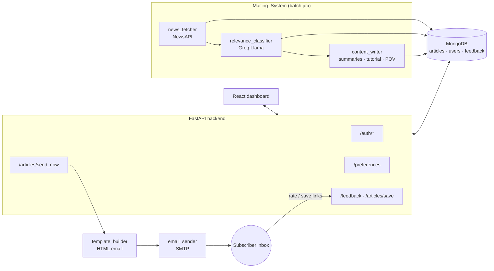

# 📰 GenAI News Mailer

**An AI-curated Generative AI newsletter: fetches the latest news, filters it with an LLM, writes summaries, a tutorial and an editorial POV, and emails each subscriber a personalized digest with a dashboard to manage it.**


---

## ✨ Features

- **News ingestion**: pulls articles for GenAI-focused queries (OpenAI, DeepMind, Anthropic, AI tools…) from NewsAPI and scrapes the full content.
- **LLM relevance filter**: a Groq-hosted Llama model classifies every headline and keeps only genuine Generative AI news.
- **AI content writing**: generates concise and detailed summaries for each article, a short tutorial, and an **Editor's POV** that connects themes across the week's stories.
- **Personalized HTML emails**: hero story, top stories, industry insights, tutorial and POV, with one-click *save article* links and a 5-star rating footer.
- **Feedback loop**: email ratings and "save" clicks are logged to MongoDB, and per-user sent history prevents duplicate articles.
- **Subscriber dashboard (React)**: sign-up/login (bcrypt), password reset by email, topic and frequency preferences, saved articles, and a "send me one now" button.

## 🏗️ Architecture



## 📂 Project structure

```
GenAI-News-Mailer/
├── Mailing_System/
│   ├── mail.py                 # batch job: fetch → classify → summarize
│   ├── news_fetcher.py         # NewsAPI client
│   ├── relevance_classifier.py # LLM "is this GenAI news?" filter
│   ├── content_writer.py       # summaries, tutorial, editorial POV (Groq)
│   ├── template_builder.py     # responsive HTML newsletter
│   ├── email_sender.py         # SMTP sender
│   └── database_handler.py     # MongoDB access + full-article scraping (BeautifulSoup)
├── backend/
│   ├── main.py                 # FastAPI app (auth, preferences, feedback, send)
│   └── requirements.txt
├── frontend/                   # React 19 + React Router dashboard
└── .env.example
```

## 🚀 Getting started

**Prerequisites:** Python 3.9+, Node.js 18+, MongoDB running locally (or a connection string), a [Groq](https://console.groq.com) API key, a [NewsAPI](https://newsapi.org) key, and an SMTP account (for Gmail, create an App Password).

```bash
git clone https://github.com/tyagipriyansh07/GenAI-News-Mailer.git
cd GenAI-News-Mailer
cp .env.example .env            # fill in your keys
```

**1. Build the frontend.** The backend serves the built app.

```bash
cd frontend
npm install
npm run build
cd ..
```

**2. Start the backend** (from the repo root):

```bash
python -m venv venv
venv\Scripts\activate           # macOS/Linux: source venv/bin/activate
pip install -r backend/requirements.txt
uvicorn backend.main:app --port 5000 --reload
```

Open http://localhost:5000, create an account, and set your preferences.

**3. Run the news pipeline** to populate articles:

```bash
cd Mailing_System
python mail.py
```

Then click **Send now** on the dashboard, or call `POST /articles/send_now`.

> For frontend hot-reload during development, run `npm start` in `frontend/`. It reads `REACT_APP_API_URL` (default `http://localhost:5000`).
> To make email links work outside your machine, expose the backend (for example with ngrok) and set `PUBLIC_BASE_URL`.

### Environment variables

| Variable | Purpose |
|---|---|
| `MONGO_URI` | MongoDB connection string |
| `GROQ_API_KEY`, `GROQ_MODEL` | LLM for classification and writing (default `llama-3.1-8b-instant`) |
| `NEWS_API_KEY` | NewsAPI key |
| `SENDER_EMAIL`, `SENDER_PASSWORD` | SMTP credentials (use an app password) |
| `PUBLIC_BASE_URL` | Base URL used in email links (save, feedback, dashboard) |

## 🔌 API

| Method | Endpoint | Description |
|---|---|---|
| `POST` | `/auth/signup`, `/auth/login` | Account creation and login (bcrypt) |
| `POST` | `/auth/forgot_password`, `/auth/reset_password` | Emailed reset link (1-hour token) |
| `GET/POST` | `/preferences` | Read and update topic and frequency preferences |
| `GET` | `/articles/saved` | A user's saved articles |
| `POST` | `/articles/save` · `GET /articles/save_legacy` | Save an article (the GET version is used by email links) |
| `POST` | `/feedback` · `GET /feedback/email_rate` | Dashboard feedback and 1–5 star email ratings |
| `POST` | `/articles/send_now` | Build and send a digest to a user immediately |

## 🗺️ Roadmap

- Scheduled sending (cron or APScheduler) based on each user's frequency preference
- Embedding-based personalization from saved articles and ratings
- Persist reset tokens in the DB and add JWT sessions
- Docker Compose for MongoDB, the API and the pipeline

## 👤 Author

**Priyansh Tyagi**, GenAI & ML Engineer · [GitHub](https://github.com/tyagipriyansh07) · [LinkedIn](https://www.linkedin.com/in/priyanshtyagi07)
